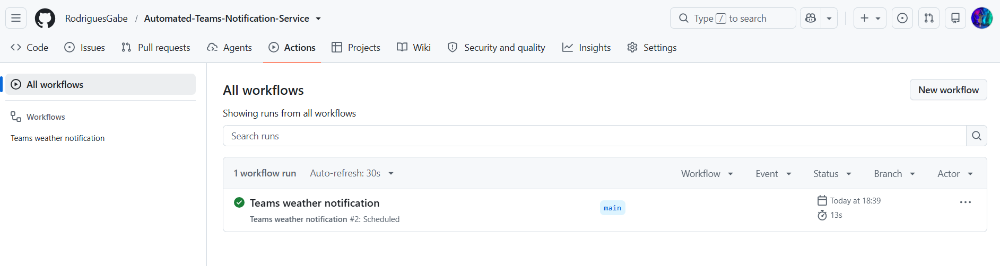
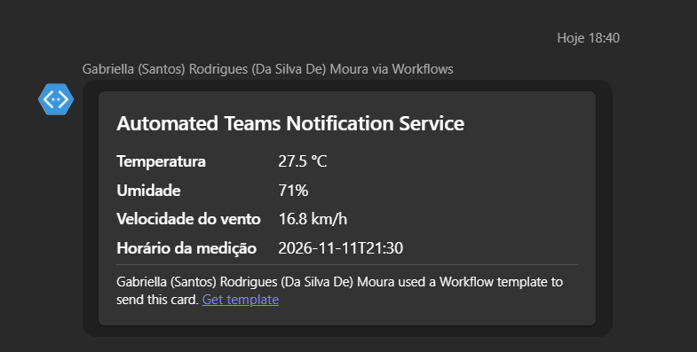

# Automated Teams Notification Service

Envia um Adaptive Card com as condições meteorológicas atuais de Recife para um grupo do Microsoft Teams.

## Sobre o projeto

Este projeto foi inspirado em uma automação que desenvolvi no trabalho para um
cliente, com notificações de monitoramento enviadas ao Teams de hora em hora.
Esta é uma versão demonstrativa preparada para publicação: usa a API pública
Open-Meteo para obter dados meteorológicos de Recife e, por padrão, envia uma
notificação mensal via Github Actions.

Esta versão não inclui código, dados, credenciais ou configurações específicas
do cliente. A frequência mensal e o uso de uma API pública são escolhas desta
demonstração e podem ser ajustados para outros casos de uso.

## Demonstração

Execução agendada do workflow no GitHub Actions:



Adaptive Card recebido no grupo do Microsoft Teams:



## Adaptar para outra API ou conteúdo

Para usar outra API, ajuste a URL e os parâmetros em `src/config.py` e adapte
`format_weather` em `src/notifier.py` para extrair os campos da resposta dessa
API. O conteúdo visual do Adaptive Card é montado por `build_teams_payload` no
mesmo arquivo: altere o payload para exibir os campos e o layout adequados ao
seu cenário. O endpoint do webhook do Teams deve continuar configurado como o
segredo `TEAMS_WEBHOOK_URL`; não o coloque no código ou no README.

## Executar localmente

1. Instale as dependências:

   ```powershell
   python -m pip install -r requirements.txt
   ```

2. Crie um arquivo `.env` na raiz do projeto e adicione a URL do webhook:

   ```env
   TEAMS_WEBHOOK_URL=sua_url_de_webhook
   ```

3. Execute:

   ```powershell
   python src/notifier.py
   ```

Não publique o arquivo `.env` nem compartilhe a URL do webhook.

## Agendamento pelo GitHub Actions

O workflow em `.github/workflows/teams-notification.yml` envia uma notificação
uma vez por mês, todo dia 9 às 09h no horário de Brasília. O workflow também
pode ser iniciado manualmente pela aba **Actions**.

Para configurá-lo:

1. No GitHub, abra o repositório e vá a **Settings → Secrets and variables →
   Actions**.
2. Clique em **New repository secret** e crie um segredo chamado
   `TEAMS_WEBHOOK_URL`. Cole a URL real do webhook como valor.
3. Faça push do workflow para a branch padrão do repositório.
4. Para testar sem esperar o cron, abra **Actions → Teams weather notification
   → Run workflow**.

O cron é interpretado em UTC. A expressão `0 12 9 * *` corresponde a 12h UTC
no dia 9 de cada mês, ou 9h no horário de Brasília (UTC−3). O GitHub pode
atrasar execuções agendadas em períodos de alta demanda.

Para mudar a frequência, edite o valor de `cron` no arquivo
`.github/workflows/teams-notification.yml`, faça commit e envie a alteração
para a branch padrão. Exemplos (todos em UTC):

| Expressão cron | Agendamento                         |
| -------------- | ----------------------------------- |
| `0 12 9 * *`   | Dia 9 de cada mês às 9h de Brasília |
| `0 12 * * *`   | Todos os dias às 9h de Brasília     |
| `0 * * * *`    | A cada hora, no minuto zero         |

Depois de alterar o cron, confira a conversão para UTC para que o envio ocorra
no horário local desejado. O botão **Run workflow** continua disponível para
execuções manuais, independentemente do cron.
